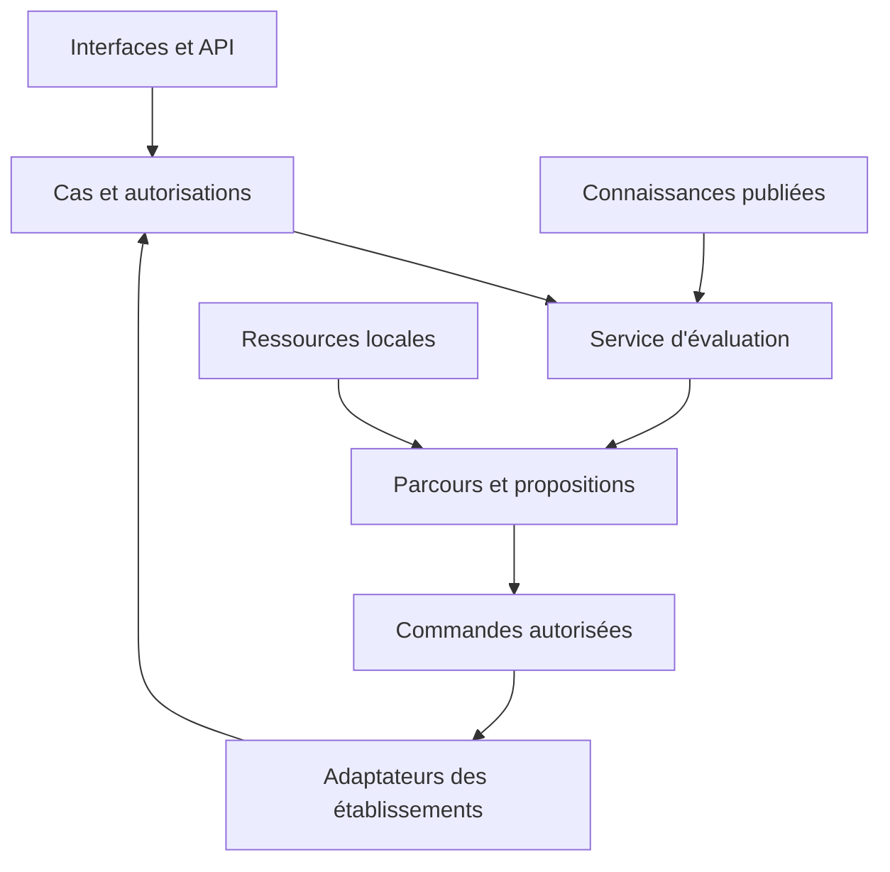

# 02 — Architecture et choix techniques

## Architecture cible

Le cœur est un monolithe modulaire avec un worker séparé utilisant les mêmes modules. Les moteurs JVM, probabilistes ou d'optimisation peuvent être des processus locaux isolés. Ils restent des adaptateurs remplaçables et non des propriétaires de données métier.

## Modules et propriété

| Module | Possède | Lit via contrat |
|---|---|---|
| identity | Comptes locaux, rôles, politiques et délégations | Assertions IdP facultatives |
| clinical_case | Cas, observations, versions et décisions du cas | Terminologies, droits |
| knowledge | Sources, assertions, preuves, publications | Révisions autorisées |
| inference | Exécutions, hypothèses et traces calculées | Snapshot du cas, modèles |
| pathways | Protocoles et propositions d'actions | Évaluation, connaissances |
| planning | Plans et comparaisons de stratégies | Actions admissibles, ressources |
| resources | Capacités, snapshots de disponibilité, coûts et réservations MediKristal | Reçus externes |
| treatment | Options thérapeutiques et évaluations de compatibilité | Cas, médicaments, protocoles |
| contributions | Propositions scientifiques et décisions de révision | Artefacts de connaissance |
| integrations | Operations, inbox/outbox et liaisons étrangères | Exports autorisés des propriétaires |
| audit | Journal technique d'accès et de mutations | Événements minimisés |

Un module n'importe pas le modèle ORM privé d'un autre pour le modifier. Les lectures optimisées intermodules passent par une projection documentée. Les contraintes transactionnelles communes peuvent être implémentées dans la même base, sans effacer la propriété.

## Pile de référence et évolution

La capture livre Python 3.12 comme version cible, FastAPI et Pydantic pour l’API, SQLAlchemy et Alembic pour la persistance et les migrations, PostgreSQL 16 comme base de déploiement de référence, et une interface HTML/CSS/JavaScript sans chaîne de build. SQLite sert aux essais isolés. Le premier travail sur la livraison porte sur le verrou, le SBOM et la campagne PostgreSQL réelle. Voir [l’état de la capture](ETAT_2026-11-27.md).

Le cœur reste un monolithe modulaire avec un worker dans le même code. Le modèle sémantique reste logique et PostgreSQL sert de stockage transactionnel. Toute nouvelle infrastructure, bibliothèque spécialisée ou séparation de service répond à un besoin mesuré et documenté au chapitre 20. CQF et l’optimisation spécialisée demeurent des adaptateurs candidats à qualifier. Le [système final](SYSTEME_FINAL.md) définit l’architecture de déploiement et les mesures de validation.

## Transactions

Un cas d'usage valide le principal, le tenant, la révision attendue et les invariants ; il écrit état et outbox dans une transaction. Les appels externes ont lieu après commit. Pas de transaction distribuée entre établissement, Kristal et MediKristal. Les lecteurs d'évaluation travaillent sur un snapshot immuable. Un retour tardif ne remplace jamais une version plus récente.

## Ports

Chaque adaptateur expose `capabilities`, `health`, versions supportées, classification des données admises, timeout et erreurs typées. Le noyau ne dépend pas d'un SDK commercial. L'adaptateur ne décide jamais de l'autorisation d'une prescription ou de la reconnaissance d'une assertion. Les ports détaillés sont au chapitre 13.

## Registre de capacités

Une capacité est `available`, `degraded`, `unavailable`, `not_configured` ou `not_qualified`. Elle déclare connectivité requise, coût, licence de données, couverture clinique et preuve de qualification. Le frontend reflète ce registre ; il ne déduit pas la capacité de la seule présence d'un bouton.

## Limites et budgets techniques initiaux

Budgets d'ingénierie configurables : payload JSON 2 MiB, page 100 éléments maximum, temps d'évaluation interactive 10 s avant traitement asynchrone, taille et complexité des modèles plafonnées, résultats de recherche 50 par défaut. Ces budgets ne sont pas des seuils cliniques. Tester sur un poste de référence déclaré dans les résultats de performance ; ne pas revendiquer de débit sans mesure.
