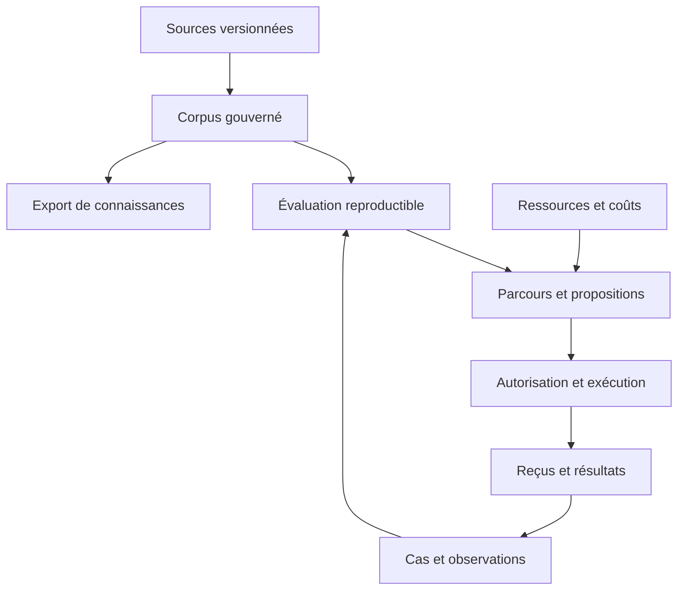

# MediKristal — Architecture du système final

**Version du document** 2.0 · **Date** 27 novembre 2026 · **Statut** architecture cible proposée  
**Point de départ** MediKristal 0.2.0, spécification 1.1. L’état observé et les vérifications sur la capture sont consignés dans [l’audit du 27 novembre](ETAT_2026-11-27.md).

## Parcours et rôles de la cible 2.0

L’atelier livré décrit et exécute [le parcours d’épisode](LIVRAISON_2.0.md). Le même épisode suit les observations du patient et la reprise par l’équipe. Le moteur détermine la prochaine question ou vérification utile, puis réévalue les hypothèses lorsque les résultats reviennent. L’urgence suit la procédure applicable. La responsabilité de la décision et sa signature restent attribuées à l’acteur habilité.

Le Kristal **Hospital Ops** porte les procédures versionnées, leurs rôles, les conditions d’entrée et d’escalade. La capacité courante, les personnes disponibles et les reçus relèvent des systèmes propriétaires. La base analytique conserve les projections autorisées et les évaluations. Le Kristal de connaissances publie les estimations et versions de modèles admises. Les données identifiantes et révisions d’épisodes suivent leurs propres accès et leur propre cycle.

## Résultat attendu

MediKristal réunit un référentiel médical gouverné et une application autonome d’orchestration des parcours. Une équipe peut installer un corpus admis, retrouver la source d’une assertion, évaluer un cas avec une version précise des connaissances, comparer des stratégies et suivre les actions approuvées jusqu’à leur résultat. Chercheurs et réviseurs disposent d’un circuit de contribution distinct. Une édition de savoir partageable peut alimenter un lecteur local ou une publication externe.

L’installation de référence conserve un monolithe modulaire FastAPI, PostgreSQL, les migrations Alembic, un worker issu du même code et une interface Web. Une installation autonome utilise le même noyau. Les moteurs spécialisés, fournisseurs et systèmes partenaires se branchent par adaptateur lorsqu’un besoin et une preuve d’intégration le justifient.

## Architecture et autorités

| Domaine | Autorité d’écriture | Échange |
| --- | --- | --- |
| Savoir médical et modèles | MediKristal conserve sources, assertions, preuves, versions, décisions de revue et releases locales | Références immuables et exports bornés par les droits |
| Dossier et évaluations | Le tenant MediKristal conserve les révisions du cas, les permissions et les traces calculées | Observations, résultats et commandes explicitement autorisés |
| Ressources et opérations | MediKristal conserve les propositions, claims locaux et opérations. L’établissement confirme ses actes et ses réservations | Demande corrélée, état durable, reçu et réconciliation |
| Artefact Kristal | Le profil Framework adopté définit la forme et les identités. L’Authoring Kit gouverne le workspace qu’il possède | Artefact de savoir déclaratif avec profil, versions, empreintes et provenance |
| Activation et diffusion | Le runtime propriétaire décide de l’activation de son paquet. UCKK possède ses représentations de diffusion | Soumission explicite et reçus par destination |
| Qualification | LevelUpDiag examine une livraison précise. Les responsables désignés évaluent l’usage clinique et autorisent son déploiement | Preuves datées, liées à l’artefact et à l’environnement |

Chaque adaptateur annonce opérations, version de contrat, droits, limites, timeout et capacité observable. Une intégration utilise un transport explicite. Les produits conservent leurs propres stores, permissions et décisions. Voir [les frontières d’intégration](14-integrations.md) et [la qualification indépendante](FINAL_SYSTEM_ENGINEERING_BOUNDARY.md).

## Parcours et états

### Savoir, revue et distribution

1. **Ingestion.** Identifier fournisseur, version, juridiction, licence, droits et empreinte. Conserver le brut en quarantaine avec son reçu. En cas d’écart de format, de licence ou de mapping, exposer la raison et suspendre l’admission.
2. **Structuration.** Normaliser concepts, assertions, estimations de preuve et liens. Conserver la version du code natif, le contexte, les conflits et les passages sources. Une correspondance ambiguë reste candidate.
3. **Revue.** Comparer les versions. Enregistrer périmètre, compétences des réviseurs, décision et réserves. Les contributions scientifiques et les propositions assistées par IA suivent ce circuit. Une lecture Smart Vote, si adoptée, constitue une pièce de revue. La promotion relève d’une décision distincte.
4. **Release.** Figer contenu et dépendances par empreinte. Vérifier intégrité, droits et état de revue avant admission locale. Une révocation bloque les nouvelles utilisations concernées, conserve l’historique et identifie les évaluations et publications affectées.
5. **Export.** Sélectionner des objets de savoir partageables à partir de la release, vérifier droits et provenance, puis mapper et valider sur le profil Kristal épinglé. Distinguer préparation, validation, soumission et reçu. Un paquet exécutable ou une diffusion UCKK suit ensuite la politique de sa destination.

### Cas, parcours et suivi

1. Enregistrer l’observation et sa provenance sur une révision du cas. Conserver présence, absence, inconnu et contradiction. Une correction append-only invalide les sorties dépendantes, tout en conservant leur historique.
2. Figer la révision du cas, la release, le modèle et les paramètres admis pour l’évaluation. Séparer score, probabilité calculée et statut de couverture. Renvoyer les données insuffisantes et les contradictions explicitement. Le prix et la disponibilité n’entrent pas dans l’estimation de maladie.
3. Appliquer le protocole versionné, puis comparer les seules stratégies admissibles. Afficher raisons, délai, coûts par perspective et hypothèses. Un coût inconnu reste inconnu. Un plan expose sa validité et doit être réévalué lorsque ses dépendances changent.
4. Après autorisation, inscrire état et outbox dans la même transaction. Dédupliquer les demandes et les retours. Une réponse distante ambiguë entraîne une réconciliation avant toute répétition. Un reçu d’acceptation, une confirmation et un résultat restent des états distincts.
5. Rattacher le résultat au cas et reprendre l’évaluation si le protocole le prévoit. Affecter le suivi à un responsable avec une preuve de clôture. Les options et contrôles thérapeutiques sont des objets revus avec leur couverture et leur provenance. Toute ordonnance effective relève d’un circuit et d’une habilitation explicites.

En mode de référence, l’application reste en `proposal_only`. Le mode, la politique d’exécution et les permissions restent vérifiés côté serveur. Les parcours détaillés et leurs erreurs sont spécifiés dans les [contrats opérationnels](30-operational-contracts.md) et les [scénarios d’acceptation](33-acceptance.md).

La [première tranche de consultation](IMPORTER_REFERENTIELS_PUBLICS.md) existe sous forme d’index SQLite local en lecture seule. L’API v2 et l’interface Épisodes exposent la recherche et sa provenance via une frontière dédiée. Les référentiels restent une source de consultation tant que les objets concernés n’ont pas suivi le circuit de revue et d’admission.

## Interfaces et modes

| Surface | Résultat attendu |
| --- | --- |
| Patient | Saisie guidée, correction et suivi des états qui lui sont accessibles |
| Professionnel | Révision du cas, sources, hypothèses, recommandations à examiner, autorisations et suivi des reçus |
| Administration et exploitation | Ressources, disponibilités, coûts, capacités, incidents, files et reprise selon le rôle |
| Révision scientifique | Comparaison de versions, preuve, contribution, décision et retrait |
| API et lecteurs | Contrats versionnés et projections bornées. Le lecteur de connaissances reçoit un corpus admis et ses sources. |

Le profil `offline_free` sert de base. L’essai strict interdit le WAN et teste le parcours avec les seules dépendances installées. Un LAN d’établissement exige un profil explicite. `online_free` ouvre des sources autorisées. `online_extended` ajoute les fournisseurs approuvés avec réservation de budget, finalité, minimisation et réconciliation. Les pannes conservent les fonctions locales disponibles et exposent la fraîcheur des sources. Voir [les modes](12-modes.md) et [les interfaces](31-ui-acceptance.md).

### Français, anglais et accès IA

Conserver une identité sémantique commune et distinguer le code source, les libellés, les définitions et les réalisations. Pour l’export v11, utiliser les identités du registre choisi, des dictionnaires séparés et un crosswalk externe versionné lorsqu’il est admis. Conserver les libellés officiels sous leurs droits. Essayer d’abord `fr-CA` et `en-CA`, avec couverture directe, repli signalé et résultat manquant testés. Une instruction destinée au soin requiert une réalisation admise pour la langue, la portée et le public. SemantiK Architect peut fournir un rendu par contrat, avec contrôle de fidélité sur négations, valeurs, unités, dates et limites. L’IA peut chercher, structurer ou expliquer avec citations et statut. L’admission et les mutations restent soumises aux permissions locales.

## Optimisation fonctionnelle et technique

| Levier | Choix de conception | Ce qu’il faut mesurer ou démontrer |
| --- | --- | --- |
| Planification individuelle | Comparer d’abord l’ensemble fini de stratégies du protocole. Filtrer les contraintes impératives puis exposer les compromis. Calculer une utilité numérique seulement si le modèle et les utilités couvrent la comparaison. | Fixtures avec branches manquantes, coûts inconnus, corrélations et changements de classement. |
| Ordonnancement collectif | Affecter les demandes admissibles dans les capacités réelles. Préserver l’ordre des priorités de la politique et revérifier la disponibilité avant claim. En timeout, afficher le statut de la solution admissible. | Concurrence PostgreSQL, absence de surbooking, équité selon la politique, taux d’infaisabilité et réconciliation. |
| Lecture et réévaluation | Paginer les listes. Réutiliser les résultats coûteux uniquement à permissions et entrées identiques. Inclure version du cas, release, modèle et politique dans la validité. Construire des projections de lecture si les mesures en montrent l’utilité. | Latence p50/p95/p99 par parcours, requêtes SQL, mémoire et tests de non-réutilisation après correction, révocation ou changement d’accès. |
| Imports et jobs | Dédupliquer les blobs par tenant et digest. Traiter les imports par lots bornés. Séparer la requête interactive du travail durable et récupérer les opérations interrompues. | Temps d’import et d’activation, âge de la file, reprises, doublons, débit et contention sous plusieurs workers. |
| Exploitation locale | Distribuer un paquet installable sans WAN. Mesurer sur une machine de référence avant d’ajouter des services ou de fixer les cibles de performance. | Démarrage à froid, charge reproductible, empreinte disque, sauvegarde/restauration, retour à une release admissible. |

La [politique d’optimisation](28-optimization.md) définit les critères métier. Le [profil de qualification](PROFIL_QUALIFICATION.md) propose des seuils de charge, de latence et de reprise avec machine, taille du jeu, concurrence et méthode de mesure. Le [registre des patterns](PATTERNS_ARCHITECTURE.md) rattache les choix à leurs preuves.

## Cloisonnement, exploitation et reprise

Appliquer tenant, rôle et grant de cas à chaque accès. Séparer données individuelles, corpus et télémétrie. La publication sélectionne les types de données autorisés et échoue si l’objet, ses métadonnées ou ses références sortent de ce périmètre. Les secrets restent dans la configuration protégée. L’audit enregistre acteur, finalité, références, décision et corrélation avec minimisation du contenu.

Qualifier les migrations sur PostgreSQL réel et les reprises avec des transactions concurrentes. Sauvegarder base, objets et métadonnées de release de façon cohérente. Vérifier une restauration complète, la reprise des opérations en cours et le comportement après révocation. Rejouer un résultat historique avec ses versions exactes dans un environnement autorisé. Documenter les résultats et les limites dans les [preuves d’exploitation](17-operations.md).

## Ordre de réalisation et preuves attendues

| Étape | Livrable | Preuve de sortie |
| --- | --- | --- |
| 1. Livraison reproductible | Source complète, verrou exact, inventaire et SBOM alignés | Contrôle d’intégrité, suite Python 3.12, migration et smoke PostgreSQL/Docker, rapport indépendant |
| 2. Parcours autonome | Cas synthétique, résultat, correction et réévaluation hors WAN | Scénario reproductible, permissions vérifiées, reprises testées sous concurrence |
| 3. Interopérabilité ciblée | Export local d’un artefact de savoir synthétique vers un profil Kristal choisi | Fixtures positives et négatives, versions et empreintes, provenance complète, résultat déterministe, cas exclus, lecture côté consommateur |
| 4. Corpus gouverné et lecture bilingue | Première release de référence à périmètre précis, sources sous droits et revue documentée | Traçabilité et révocation, restauration, états linguistiques et revue par public |
| 5. Intégrations de site et diffusion | Adaptateurs qualifiés séparément pour FHIR, kOA et les destinations retenues | Contrats réels, tests de bout en bout, refus et résultats ambigus, reçus et retrait côté destinataire |
| 6. Usage clinique défini | Qualification pour une population, une finalité et un environnement précis | Dossier indépendant de sécurité, confidentialité, performance clinique et autorisation applicable |

Le [backlog exécutable](BACKLOG_SYSTEME_FINAL.md) précise les points d’entrée, les dépendances et les tests par ticket.

### Scénario transversal de référence

Installer hors WAN le paquet et un corpus synthétique admis. Importer une version de source, publier localement la release de test puis ouvrir un cas fictif. Enregistrer une observation, produire une évaluation rejouable, comparer deux stratégies et créer une proposition. Sur un établissement synthétique, rejouer la demande, simuler un retour ambigu et vérifier qu’une réconciliation précède toute répétition. Rattacher ensuite le résultat. Corriger l’observation et vérifier l’invalidation puis la réévaluation. Exporter uniquement un objet de savoir de la release, lire sa provenance et vérifier qu’aucune référence du cas ne traverse cette frontière. Enfin, retirer la release et vérifier les effets sur les nouveaux usages et la conservation des traces.

Capturer les versions et digests, le statut des capacités, les traces de corrélation et le rapport de vérification côté consommateur. Rejouer les rôles non autorisés, le changement de tenant, l’absence d’adaptateur, la rupture réseau et un redémarrage en cours d’opération. Les étapes 1 à 3 avancent avec des fixtures synthétiques.

Restent à décider avec les propriétaires concernés : périmètre du premier corpus, profil d’export exact, consommateurs et profils FHIR retenus, politiques de conservation et objectifs mesurables par site. Chaque étape conserve les références aux exigences de la [matrice de traçabilité](../contracts/traceability.json). Les résultats logiciels portent sur leur périmètre d’essai. L’usage clinique relève de la qualification de l’étape 6.

## Documents sources

La capture MediKristal du 27 novembre fournit les contrats 0.2.0, le code, les exemples et la matrice. Les choix de ce document s’appuient sur les [ADR existantes](20-decisions.md), les [lots de développement](19-delivery.md) et la frontière [FC-20 / FC-18](FINAL_SYSTEM_ENGINEERING_BOUNDARY.md). Les versions des satellites proviennent de leurs snapshots joints. Les références sont résumées dans le [chapitre d’intégration](14-integrations.md).
